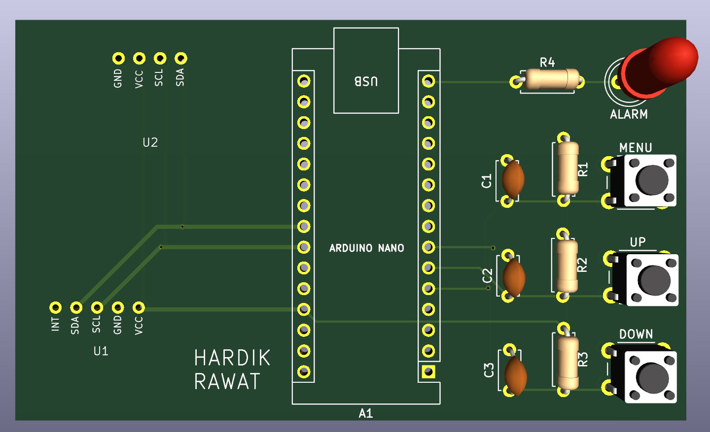
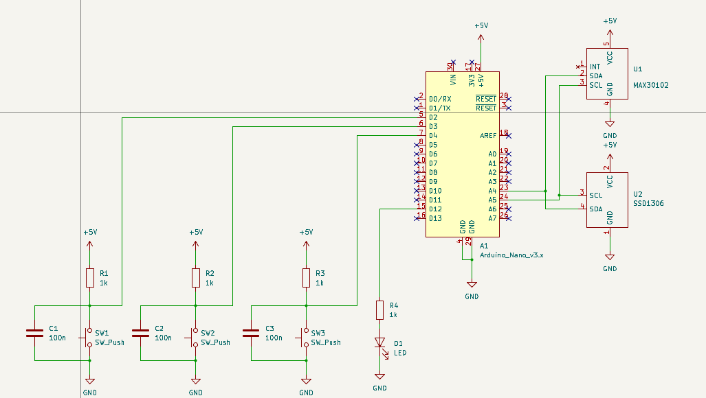
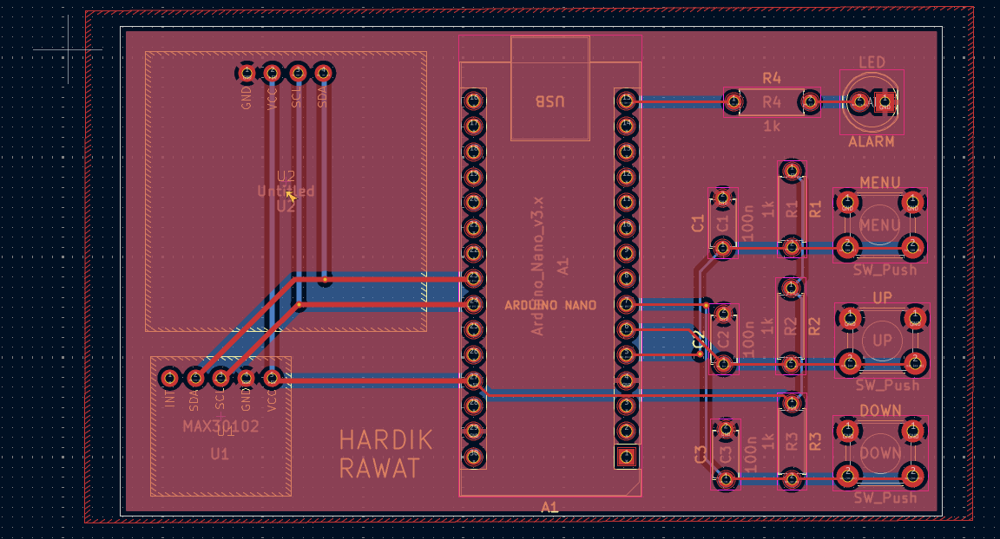
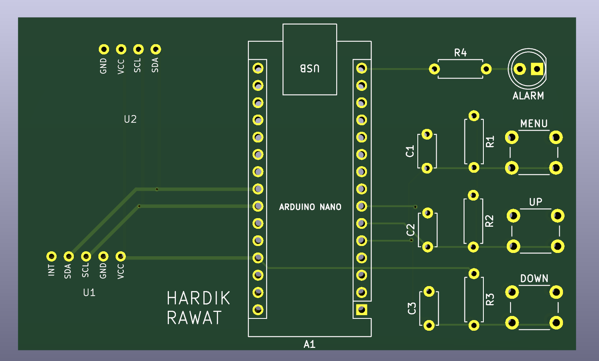

[← Back to the PCB journey](../../README.md)

# Board 01: Pulse Monitor, my first PCB

   

This is my first PCB, designed from scratch in KiCad 9 on 12–13 October 2026. It is a carrier board that joins an **Arduino Nano**, a **MAX30102** heart-rate and SpO₂ sensor, a **0.96" SSD1306 OLED** and three navigation buttons, with an alarm LED. It is laid out for a pulse-monitor build.

Designed by **Hardik Rawat**.



> [!NOTE]
> **Status: routing complete, not yet fabricated.** Every net is connected and the GND pour is filled on both layers. It is a 2-layer board. DRC passes with 0 errors. Before ordering, the main thing left is to confirm that the header pin order matches the real modules. The full list and a pre-order checklist are in [docs/design-review.md](docs/design-review.md).

---

## What's on the board

| Part | Ref | Connects to |
| --- | --- | --- |
| Arduino Nano v3 | A1 | Main controller, powered over its USB port |
| MAX30102 sensor module | U1 | I²C: SDA → A4, SCL → A5; VCC → +5V |
| SSD1306 OLED module | U2 | I²C: SDA → A4, SCL → A5; VCC → +5V (shared bus) |
| MENU button | SW1 | D2, with R1 (10 kΩ) pull-up and C1 debounce cap |
| UP button | SW2 | D3, with R2 pull-up and C2 debounce cap |
| DOWN button | SW3 | D4, with R3 pull-up and C3 debounce cap |
| ALARM LED | D1 | D12 through R4 (1 kΩ) |

Both modules share one I²C bus. Their addresses don't clash: 0x57 for the MAX30102 and 0x3C for the SSD1306. The full parts list is in [bom/BOM.csv](bom/BOM.csv).

## Schematic



## PCB layout

82 × 49 mm, all through-hole parts, with tracks on the top (red) and bottom (blue) copper layers.



| 3D render with parts | Bare board |
| :---: | :---: |
|  |  |

## Folder layout

```
boards/01-pulse-monitor/
├── README.md
├── hardware/                     KiCad 9 project
│   ├── Praticenew.kicad_pro
│   ├── Praticenew.kicad_sch      schematic
│   ├── Praticenew.kicad_pcb      board layout
│   ├── sym-lib-table             project symbol library table
│   ├── fp-lib-table              project footprint library table
│   └── libraries/
│       ├── New_Library.kicad_sym           custom MAX30102 + SSD1306 symbols
│       └── Library.pretty/                 custom MAX30102 + SSD1306 footprints
├── bom/BOM.csv                   bill of materials
└── docs/
    ├── design-review.md          known issues and the pre-order checklist
    └── images/                   schematic, layout and 3D renders
```

## Opening the project

1. Install **KiCad 9.0 or newer**. The files are in KiCad 9 format and won't open in KiCad 8 or earlier.
2. Clone the repo and open `boards/01-pulse-monitor/hardware/Praticenew.kicad_pro`.
3. The custom symbols and footprints load automatically through the project's `sym-lib-table` and `fp-lib-table`. You don't need to set up any global libraries.

## Manufacturing (once the checklist is done)

1. In the PCB editor, fill the zones (**B**) and run DRC until it shows 0 errors.
2. Go to File → Fabrication Outputs → Gerbers, and export F.Cu, B.Cu, F.Mask, B.Mask, F.Silkscreen, B.Silkscreen and Edge.Cuts.
3. Click **Generate Drill Files** (Excellon, PTH and NPTH merged).
4. Zip the outputs into `fabrication/` and check them in a Gerber viewer before uploading to a fab house.

Suggested order settings: 2 layers, 1.6 mm FR-4, HASL finish, 1 oz copper.

## Next steps

- [x] Finish routing and fill the GND pour
- [x] Pass DRC (0 errors, 0 unconnected)
- [ ] Check header pin order against the real modules ([design-review.md](docs/design-review.md))
- [ ] Export Gerbers and order the first batch
- [ ] Assemble, test, and add photos of the real board
- [ ] Write firmware: read the MAX30102, show BPM and SpO₂ on the OLED, and use the buttons for menus and alarm limits

## What I learned

- **A copper pour isn't copper until you fill it.** Press **B** before saving, every time. An unfilled GND zone leaves every ground pin disconnected.
- **Ctrl+B unfills zones.** It's easy to press by accident.
- **Change values in the schematic, then press F8.** Values edited only on the PCB get overwritten the next time you update the PCB from the schematic.
- **Check the board stackup.** A new board defaulted to 4 copper layers, which costs several times as much to order as 2.
- **A pull-up and a current-limiting resistor are different jobs.** 10 kΩ suits the button pull-ups, but the LED needs about 1 kΩ to be visible.
- **An asterisk in the title bar means unsaved changes.** What's on screen isn't in the file until you press Ctrl+S.
